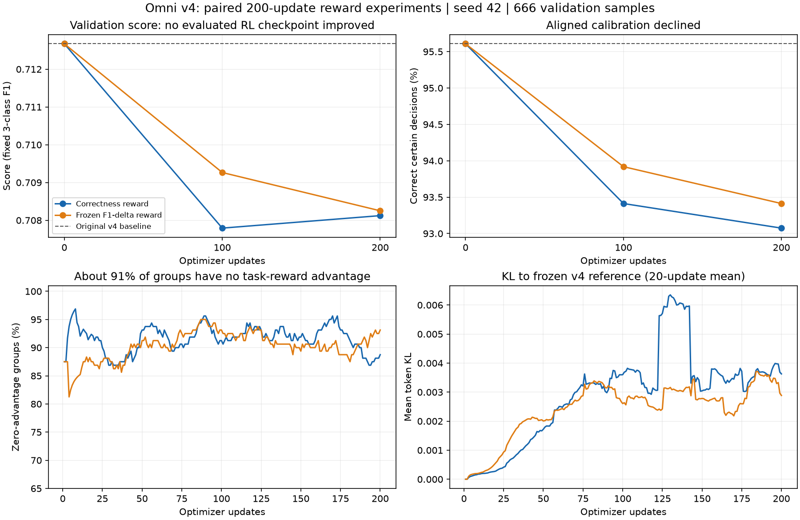

# Omni v4 双卡奖励对比结果（2026-10-22）

两套实验均完成 200 次参数更新、100/200 步的完整 666 条验证，以及预定的保存检查。F1 分支完成了 3,354 条训练集参考缓存、10 步验收及恢复检查。四个已评估的 RL checkpoint 均未达到晋级条件，当前应继续保留原始 v4。未生成或提交新的 Kaggle 测试结果，本文成绩全部来自本地验证集。

**验证结果。** 使用本次已约定的 `fixed3_v1`：固定 positive、negative、neutral 三类 Macro-F1，Score = 0.5 × Macro-F1 + 0.3 × Conflict accuracy + 0.2 × Aligned calibration。验证集实际为 252 positive、414 negative、0 neutral，Conflict 74 条、Aligned 592 条。

| 模型 | 更新步数 | Macro-F1 | Conflict | Aligned | Score | 相对同次 v4 的 Score 变化 |
|---|---:|---:|---:|---:|---:|---:|
| 原始 v4，同环境复评 | 0 | 0.62940 | 0.68919 | 0.95608 | **0.71267** | — |
| correctness_v1 | 100 | 0.62842 | 0.68919 | 0.93412 | 0.70779 | -0.00488 |
| correctness_v1 | 200 | 0.63044 | 0.68919 | 0.93074 | 0.70812 | -0.00455 |
| f1_delta_v1 | 100 | 0.62934 | 0.68919 | 0.93919 | 0.70926 | -0.00341 |
| f1_delta_v1 | 200 | 0.62934 | 0.68919 | 0.93412 | 0.70825 | -0.00442 |

F1 分支较好的已评估结果在第 100 步，但仍低于 v4；这一次 seed 42 的结果不足以推断某种奖励普遍更优。只有 100/200 步做了完整生成验证，不能断言其余已保存 checkpoint 一定更差或一定更好。

**退化的具体来源。** 四个 RL checkpoint 的全部 74 条 Conflict 不确定性判断均与基线相同，正确识别始终为 51/74；自然 `ch_sims_v2` 冲突仍为 6/25（24%）。因此本轮没有改善原本最弱的自然冲突识别。

| 模型 | Aligned 正确判断“确定” | Aligned 误报“不确定” | 相对 v4 新增误报 |
|---|---:|---:|---:|
| 原始 v4 | 566/592 | 26 | — |
| correctness，100 步 | 553/592 | 39 | 13 |
| correctness，200 步 | 551/592 | 41 | 15 |
| F1，100 步 | 556/592 | 36 | 10 |
| F1，200 步 | 553/592 | 39 | 13 |

新增变化全部是 Aligned 从 `no` 变成 `yes`，没有原误报被纠正的抵消项。正确性分支 200 步的情感正确数从 631/666 增至 632/666，只净增加 1 条；Macro-F1 的增加给 Score 带来约 +0.000518，校准率下降带来约 -0.005068，合计 -0.004549。F1 分支 200 步情感正确数仍为 631/666。

本次基线及四个 RL 验证结果的 JSON 非法数、问题一致性违规数均为 0；性能退化发生在合法输出中的决策上。

**训练信号不足。** 两套正式训练各生成 6,400 个回答，组成 1,600 组，每组是同一输入的 4 个采样回答。逐条重算奖励得到：

| 训练诊断 | correctness_v1 | f1_delta_v1 |
|---|---:|---:|
| 4 个回答总奖励完全相同的组 | 1,463/1,600（91.44%） | 1,451/1,600（90.69%） |
| 至少一个组具有不同奖励 | 137 组 | 149 组 |
| 整个更新的 8 组全部零优势 | 96/200 次 | 83/200 次 |
| 情感奖励存在组内差异 | 100/1,600 组 | 53/1,600 组 |
| 训练中非法 JSON 回答 | 45/6,400 | 56/6,400 |
| 到达 128 token 上限的回答 | 1/6,400 | 4/6,400 |

当前优势为组内奖励减均值。四个奖励相同时，该组的任务奖励优势全部为零；KL 项仍可能产生梯度，所以这不等于整个优化器更新必然为零。SFT 在完整训练集上的贪心情感正确数已是 3,272/3,354（97.56%），随机抽取的大量简单输入难以通过 4 个回答产生区分信号。TRL 官方文档也将零奖励方差组占比作为训练诊断指标：[GRPO 日志指标](https://huggingface.co/docs/trl/grpo_trainer#logged-metrics)。

F1 奖励的情感项仅 82/6,400 个回答非零（1.28%）。其定义是将当前预测替换进固定的 SFT 训练混淆矩阵，再计算增量；预测与参考相同时增量为零。本轮 6,262 个回答的情感与参考相同，另有 56 个非法输出进入格式惩罚分支。由此得到的情感学习信号很稀疏，未体现出预期的 Macro-F1 收益。

训练集 neutral 仅 7 条，本次 200 步抽样中仅出现 2 次 neutral 输入；验证集没有 neutral。应检查按类别和来源的学习信号，而不能仅因奖励名称包含 F1 就认为它直接优化了线上榜单。

正确性分支的平均奖励从前 50 步的 0.9403 变成后 50 步的 0.9544，验证 Score 却下降；两窗口抽样内容不同，也不能仅凭这个变化宣称训练集收益。两种奖励的量纲不同，不能直接比较 0.95 与 0.46，也不能按 loss 数值较小来选优。不同奖励会改变原始更新幅度，参见 [TRL 对奖励缩放的说明](https://huggingface.co/docs/trl/grpo_trainer#computing-the-advantage)。

**可比性与工程检查。** 两套基线逐条预测完全相同。权重、数据、输入处理、训练源码、软件版本的身份记录一致，除奖励版本外的实验参数一致；200 步抽样的 `(update, sample_id, generation)` 序列完全一致。两套都从 v4 重新开始正式训练，没有使用验收权重。每套 11 个 checkpoint 完成标记中的 reference digest 保持不变，末步 policy digest 已与 reference 不同。

正式训练循环累计耗时为正确性 6.84 小时、F1 6.77 小时，平均每步分别 123.2 秒、121.8 秒；不含模型初始化、缓存、验证及保存开销。正确性分支于北京时间 10 月 21 日 22:27 完成，F1 全流程于 10 月 22 日 02:10 完成。训练记录的最高 allocated 显存两套均约 16.66 GiB。没有将当前服务器上其他进程计为本实验。

曲线中的 Score、校准率纵轴做了局部放大，绝对变化应以上表为准。训练诊断曲线使用截至当前步的最近 20 次更新均值，不表示独立重复实验的置信区间。

**评测复现的待查项。** 原始包 `best_checkpoint.json` 记录的历史 v4 Score 是 0.71846095，本次同环境复评是 0.71267263。本文的 RL 增减均相对后者计算，避免把历史评测差异算成 RL 变化。当前不能确定差异来自推理精度、处理器/依赖版本、输入处理细节还是其他因素，需要对照历史运行记录复现。历史 SFT 报告中的训练类型数量也与本次原始数据不同：报告为 441 Conflict，本次为 411，尚不能判定属于文档误差还是数据版本变化。

固定三类 Macro-F1 与只计出现类别的 union 版本不能混用；同一份基线预测的这两个 Score 分别为 0.71267 与 0.87002，数字变高不代表模型变好。官方对缺失类别的评分口径仍需单独核实，不能据此推算 Kaggle Public/Private Score。

**建议的后续顺序。**

1. 当前继续保留 v4，不用本轮四个已评估的 RL checkpoint 替换交付模型。先对齐历史推理入口与评分口径，解释 v4 复评差异。
2. 下一轮先解决高零优势比例和 Aligned 误报问题，再扩大步数。可以评估训练集内的难样本分层、预算有上限的奖励差异组重采样，以及保护 Aligned 决策的 SFT 约束/校准项。重采样会改变训练分布，必须重新检查各类型的权重与有效样本量。DAPO 官方实现有过滤同奖励组并限次数重采样的机制，但其数学推理任务上的收益不能直接当作本视频任务的效果保证：[verl DAPO 动态采样](https://verl.readthedocs.io/en/latest/algo/dapo.html#dynamic-sampling-with-group-filtering)。
3. 先做 20–40 步的小规模验证，观察有效奖励组比例、自然冲突识别及 Aligned 误报，再决定是否投入完整训练预算。现有 F1 固定参考增量奖励暂不增加预算；它需要先证明能提供足够的情感区分信号。以上均为后续建议，本次未修改训练代码或启动新任务。

**证据与复核。** 已取回 80 个结果文件并核对 SHA-256；本地逐条重算 3,996 条验证预测的汇总指标、4 次晋级判定以及 12,800 个训练回答的奖励，全部与服务器记录一致。checkpoint 完成标记已检查，未下载并重新哈希 checkpoint 的大权重文件。模型晋级条件（Score 至少提高 0.005、Macro-F1/Aligned 退化上限、自然冲突及输出约束）四个候选均未通过，因此没有 `best_checkpoint.json`。

原始数据、逐条预测与分析脚本保存在本机忽略目录 `runs/analysis-20261022/`，不提交原始模型输出。可执行 `python -B runs/analysis-20261022/analyze.py` 重算。结果压缩包 SHA-256 为 `eb8908712e0e40f8f23b7e90cb8fc007f38c9649e92acc12dae5ada173a6f4e3`；训练核心 source hash 为 `cba3547bbd9f3a9a2bc2b104a18ed5b7598b48ee1b3d055af919157c550cc789`。本次仅取回和分析结果；未重新训练、未提交 Kaggle、未 push Git。
